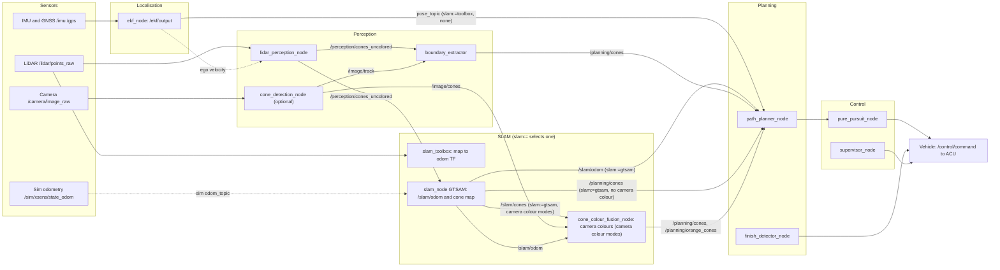

# Stack interfaces

How the stack fits together, the contract a SLAM implementation must meet, how to select one, and which topic goes where.

Paths are relative to `ros2/src/` unless they start with `docs/` or `scripts/`.

---

## Stack



Planner, pure pursuit and finish detector take their pose from `pose_topic` (bringup argument). `slam:=gtsam` overrides it with `/slam/odom`.

---

## SLAM contract

A SLAM implementation is a package with a `launch/slam.launch.py` that starts its nodes. Bringup includes that file by package name (`mfe_mapping` for `toolbox`, `mfe_validation` for `gtsam`). The contract is also written as constants in `mfe_common/mfe_common/topics.py`.

| Direction | Topic | Type | Frame | Notes |
|---|---|---|---|---|
| In | `odom_topic` (parameter) | `nav_msgs/Odometry` | any | Odometry the implementation integrates. Default `/sim/xsens/state_odom` in `mfe_validation`. Not used by bringup, which passes no remap. |
| In | `/perception/cones_uncolored` (`PERCEPTION_CONES_UNCOLORED`) | `sensor_msgs/PointCloud2` | sensor | LiDAR cone centroids from `lidar_perception_node`. Fixed name. |
| Out | `/slam/odom` (`SLAM_ODOM`) | `nav_msgs/Odometry` | `map`, child `base_footprint` | Start-relative pose. Required for `slam:=gtsam` to drive the planner. |
| Out | cone map on `cones_topic` (parameter; `SLAM_CONE_MAP` = `/planning/cones` in bringup) | `mfe_msgs/Track` | `map` | Confirmed landmarks. The planner reads `/planning/cones`. Coloured from geometry or ground truth only: with a camera colour mode it is uncoloured and goes to `/slam/cones` (`SLAM_CONES`) instead. |
| Out (optional) | TF `map` to `odom` | TF | | Only if the implementation provides it. `slam_toolbox` does; `gtsam` does not. |

Implementations must not publish to `/planning/cones` while `boundary_extractor` runs. Bringup disables `boundary_extractor` for `slam:=gtsam` for this reason.

### Camera colour stage

SLAM output is geometric (or ground truth) coloured. Colour from the camera is a separate stage, `cone_colour_fusion_node` in `mfe_validation`, so the camera colours survive a change of SLAM implementation. It runs only for the camera colour modes (`yolo`, `orange_only`, `yolo_lidar`); `mfe_validation/launch/slam.launch.py` and `lidar_only.launch.py` start it for those modes and leave it out otherwise.

| Direction | Topic | Type | Notes |
|---|---|---|---|
| In | `/slam/cones` (`SLAM_CONES`) | `mfe_msgs/Track` | The SLAM cone map with UNKNOWN colours. Written by `slam_node` in the camera colour modes. |
| In | `/slam/odom` (`SLAM_ODOM`) | `nav_msgs/Odometry` | Car pose at each camera frame. |
| In | `/image/cones` (`IMAGE_CONES`) | `mfe_msgs/Cone` | Camera detections, one message each. |
| Out | `cones_topic` (`/planning/cones`) | `mfe_msgs/Track` | The planner map. `orange_only` leaves the planner cones UNKNOWN. |
| Out | `orange_cones_topic` (`/planning/orange_cones`) | `mfe_msgs/Track` | Orange cones, for `orange_only` and `yolo_lidar`. |
| Out | `/planning/cones_camera_colours` | `mfe_msgs/Track` | Display only: the latest map cones with their camera colour. |

Cones are matched by position (SLAM freezes each cone's position). A cone keeps its votes while it stays in the map or leaves and comes back. The colour rules are those of `cam_fusion.py`. The `yolo` fallback (`color_fallback`, geometric by default) applies here too.

---

## Selecting SLAM

Bringup has one argument:

```bash
ros2 launch mfe_bringup bringup.launch.py slam:=toolbox   # default
ros2 launch mfe_bringup bringup.launch.py slam:=gtsam use_ekf:=false   # sim
ros2 launch mfe_bringup bringup.launch.py slam:=none
```

| `slam` | Starts | Pose topic for planner, pure pursuit, finish detector | `boundary_extractor` |
|---|---|---|---|
| `toolbox` (default) | `mfe_mapping/launch/slam.launch.py`: pointcloud_to_laserscan and slam_toolbox, only when `use_slam:=true` | `pose_topic` | on, if `use_perception:=true` |
| `gtsam` | `mfe_validation/launch/slam.launch.py`: `slam_node`, with the arguments below. Runs with `run_perception:=true` or `false` | `/slam/odom` (`pose_topic` ignored) | off |
| `none` | nothing | `pose_topic` | on, if `use_perception:=true` |

`use_slam` and `pose_topic` keep their meaning. `use_slam` only applies to `toolbox`.

### Arguments for `slam:=gtsam`

These pass through to `mfe_validation/launch/slam.launch.py`. Names and defaults are those of `lidar_only.launch.py`, so the same values give the same `slam_node` parameters. They are ignored by the other choices.

| Argument | Default | `slam_node` parameter |
|---|---|---|
| `slam_lateral_vel` | `false` | `use_lateral_vel` (integrate INS lateral velocity) |
| `color_mode` | `geometric` | `color_mode` |
| `min_obs` | `2` | `min_obs_publish` |
| `max_range` | `20.0` | `max_range` |
| `publish_hz` | `5.0` | `publish_hz` |
| `freeze` | `true` | `freeze` |
| `odom_topic` | `/sim/xsens/state_odom` | `odom_topic` (odometry for yaw and speed) |

`slam_lateral_vel` keeps lidar_only's name. The other names have no `slam_` prefix because bringup has no argument they would clash with. The cone topic is fixed to `/planning/cones` and the orange topic to `/planning/orange_cones`, as in the bringup route.

With `slam:=gtsam` the LiDAR detector is not started. Under bringup it comes from the perception group (`run_perception:=true`, bringup's detector parameters). The harness instead starts it from `lidar_only.launch.py`, with its own parameters, so `run_perception:=false` is the usual setting.

### Fleet

`fleet.launch.py` takes `slam` and forwards it to the local bringup and to the remote compute and perception launches, like `pose_topic`. The `slam_*` tuning arguments above are not forwarded, so remote `gtsam` nodes use the defaults.

### Steps to add a SLAM implementation

1. Create a package with `launch/slam.launch.py`. It starts every node the implementation needs, except the LiDAR detector (bringup owns it).
2. Meet the contract above. If the implementation publishes `/slam/odom`, the pose route must point there. If it publishes the cone map on `/planning/cones`, the boundary extractor must be off.
3. In `mfe_bringup/launch/bringup.launch.py`, add the name to the `slam` choices, add a branch in `_make_slam`, and add it to `_pose_topic` and `_make_boundary_extractor` if it publishes odometry or the cone map.
4. Add the package to `mfe_bringup/package.xml` as an `exec_depend`.
5. Test with `ros2 launch mfe_bringup bringup.launch.py slam:=<name> --print` and by starting the stack in the simulator.

---

## Topic table

Publisher and subscriber names are node names. Parameter-driven names are shown with the parameter in brackets.

| Topic | Type | Publisher(s) | Subscriber(s) |
|---|---|---|---|
| `/velodyne_points` | `sensor_msgs/PointCloud2` | EUFS sim (external) | `bridge_node`; `lidar_pipeline` remap target (navigation only) |
| `/lidar/points_raw` | `sensor_msgs/PointCloud2` | `bridge_node` (sim). No hardware publisher in the repo | `lidar_perception_node`; `supervisor_node`; `finish_detector_node`; `pointcloud_to_laserscan` (remap `cloud_in`); MCAP recorder |
| `/lidar/pcl/laserscan` | `sensor_msgs/LaserScan` | `pointcloud_to_laserscan` (external) | `slam_toolbox` (external) |
| `/imu` | `sensor_msgs/Imu` | Xsens MTi driver (car); `imu_gps_emulator` (sim, `platform:=sim` with `imu_gps`) | `ekf_node`; MCAP recorder |
| `/gps` | `sensor_msgs/NavSatFix` | Xsens MTi driver (car); `imu_gps_emulator` (sim) | `ekf_node`; `supervisor_node`; MCAP recorder |
| `/can/wheel_speed` | `nav_msgs/Odometry` (`twist.linear.x`, forward speed) | CAN node on the car (not written yet, needs DBC); `bridge_node` in sim (with `can`) | `ekf_node` on `platform:=sim` and `platform:=car` |
| `/ground_truth/state` | `eufs_msgs/CarState` | EUFS (external) | `bridge_node`; `lap_validator_node` |
| `/ground_truth/state_odom` | `nav_msgs/Odometry` | `bridge_node` | `xsens_noise_node`; `imu_gps_emulator`; `ekf_node` (wheelspeed on `legacy` only); `slam_node` [`ground_truth_odom_topic`]; `compare_node` |
| `/ground_truth/cones` | `eufs_msgs/ConeArrayWithCovariance` | EUFS (external) | `bridge_node` |
| `/ground_truth/track` | `eufs_msgs/ConeArrayWithCovariance` | EUFS (external) | `bridge_node` |
| `/ground_truth/cones_colored` | `mfe_msgs/Track` | `bridge_node` | `perception_evaluator` (evaluator); `fusion_evaluator` |
| `/ground_truth/track_colored` | `mfe_msgs/Track` | `bridge_node` | `boundary_extractor`; `slam_node` [`ground_truth_track_topic`, `color_mode=gt`]; `lap_validator_node` |
| `/d435i/color/image_raw`, `/zed/left/image_rect_color` | `sensor_msgs/Image` | EUFS (external) | `bridge_node` |
| `/camera/image_raw` | `sensor_msgs/Image` | `bridge_node` | `cone_detection_node` (remap `image/input`) |
| `/camera/image/raw` | `sensor_msgs/Image` | `image_file_loader` (vision, `load_file` only); `carmaker_node` (not launched) | none |
| `camera/camera_info` (relative) | `sensor_msgs/CameraInfo` | none in repo | `cone_detection_node`; `fusion_evaluator` |
| `image/input` (relative) | `sensor_msgs/Image` | see `/camera/image_raw` | `cone_detection_node` |
| `image/depth` (relative) | `sensor_msgs/Image` | none in repo | `cone_detection_node` (only with `depth_callback`) |
| `/image/cones` | `mfe_msgs/Cone` | `cone_detection_node` | `cone_colour_fusion_node` (camera colour modes) |
| `/image/track` | `mfe_msgs/Track` | `cone_detection_node` | `boundary_extractor`; `fusion_evaluator` |
| `image/cones_image`, `image/cone_centres` | `sensor_msgs/Image`, `PointCloud2` | `cone_detection_node` | none |
| `/lidar/pcl/input` | `sensor_msgs/PointCloud2` | `file_loader` (C++) | `ground_plane_removal` |
| `/lidar/pcl/raw`, `/lidar/pcl/acc_cloud` | `sensor_msgs/PointCloud2` | none (raw); `lidar_preprocessor` (acc) | `lidar_preprocessor` (raw); none (acc) |
| `/lidar/pcl/ground`, `/lidar/pcl/objects` | `sensor_msgs/PointCloud2` | `ground_plane_removal` | none |
| `/perception/cones_uncolored` | `sensor_msgs/PointCloud2` | `lidar_perception_node` | `path_planner_node`; `boundary_extractor`; `slam_node`; `fusion_evaluator` |
| `/perception/cones_markers` | `visualization_msgs/MarkerArray` | `lidar_perception_node` | none (RViz) |
| `/debug/gpu_objects` | `sensor_msgs/PointCloud2` | `lidar_perception_node` | none |
| `/ekf/output` | `nav_msgs/Odometry` | `ekf_node` | `path_planner_node`, `pure_pursuit_node`, `finish_detector_node` (remapped to `pose_topic`); `supervisor_node` and `lidar_perception_node` (`odom_topic`, default, not remapped); MCAP recorder |
| `/sim/xsens/state_odom` | `nav_msgs/Odometry` | `xsens_noise_node` | `slam_node` [`odom_topic`, default]; planner, pure pursuit, finish detector when passed as `pose_topic` |
| `/slam/odom` | `nav_msgs/Odometry` | `slam_node` (`slam:=gtsam`) | `path_planner_node`, `pure_pursuit_node`, `finish_detector_node` (when `slam:=gtsam`); `cone_colour_fusion_node` (camera colour modes); `skidpad_planner`; `compare_node`; validation planner |
| `/slam/cones` | `mfe_msgs/Track` | `slam_node` (`slam:=gtsam`, camera colour modes) | `cone_colour_fusion_node` |
| `/planning/cones` | `mfe_msgs/Track` | `boundary_extractor` (`slam:=toolbox`, `none`); `slam_node` (`slam:=gtsam`, non-camera colour modes); `cone_colour_fusion_node` (`slam:=gtsam`, camera colour modes); `bridge_node` (`use_sim_cones_directly`) | `path_planner_node`; `finish_detector_node` (gate and line modes); `supervisor_node`; `evaluator_node` |
| `/validation/cones` | `mfe_msgs/Track` | `slam_node` (validation chain, default `cones_topic`) | `path_planner_node` (remapped in validation) |
| `/planning/orange_cones` | `mfe_msgs/Track` | `cone_colour_fusion_node` (`orange_only`, `yolo_lidar`) | `finish_detector_node` (when `orange_topic` is set to it) |
| `/planning/cones_camera_colours` | `mfe_msgs/Track` | `cone_colour_fusion_node` | none (display) |
| `/validation/centerline` | `nav_msgs/Path` | `path_planner_node` (validation remap) | `compare_node` |
| `/planning/centerline` | `nav_msgs/Path` | `path_planner_node`; `skidpad_planner` | `pure_pursuit_node`; `lap_validator_node`; `compare_node` |
| `/planning/track_left`, `/planning/track_right` | `nav_msgs/Path` | `path_planner_node` | none |
| `/planning/path_horizon` | `std_msgs/Float32` | `path_planner_node` | `pure_pursuit_node` |
| `/planning/target_speeds` | `std_msgs/Float64MultiArray` | `path_planner_node` | `pure_pursuit_node` |
| `/planning/laps_completed` | `std_msgs/Int32` | `finish_detector_node` | `path_planner_node` |
| `/planning/mission_finished` | `std_msgs/Bool` (latched) | `finish_detector_node` | `pure_pursuit_node`; `lap_validator_node` |
| `/ros_can/mission_completed` | `std_msgs/Bool` | `finish_detector_node` | none in repo (external CAN bridge) |
| `/control/command` | `fs_msgs/ControlCommand` | `pure_pursuit_node`; `finish_detector_node` (full brake, 50 Hz) | `supervisor_node`; `bridge_node`; MCAP recorder |
| `/control/command_mpc` | `fs_msgs/ControlCommand` | `mpc_lateral_node` (not launched) | none |
| `/mfe/emergency_brake` | `std_msgs/Bool` | `supervisor_node` | none in repo (external ACU) |
| `/as/supervisor/status` | `std_msgs/String` | `supervisor_node` | none in repo (external) |
| `/cmd` | `ackermann_msgs/AckermannDriveStamped` | `bridge_node` | EUFS (external) |
| `/map` | `nav_msgs/OccupancyGrid` | `slam_toolbox` (external) | none in repo (TF `map` to `odom` is used instead) |
| `/skidpad/cones` | `mfe_msgs/Track` | none in repo | `skidpad_planner`; `finish_detector_node` (gate mode) |
| `/perception/accuracy` | `diagnostic_msgs/DiagnosticArray` | `evaluator_node` | none |
| `/perception/fusion_accuracy` | `diagnostic_msgs/DiagnosticArray` | `fusion_evaluator_node` | none |

### Transforms

| Transform | Producer | Consumer |
|---|---|---|
| `base_footprint` to `velodyne`, `base_footprint` to `zed_camera_center` | `mfe_eufs_sim` launch (sim) | `boundary_extractor`, `fusion_evaluator` |
| `map` to `odom` | `slam_toolbox` (`slam:=toolbox`) or EUFS ground truth (sim with `use_slam:=false`) | `boundary_extractor`, `evaluator_node` |
| `map` to `odom` | none under `slam:=gtsam` | none |

## TF tree

`map`, `odom` and `base_footprint` follow REP 105. The stack looks up `map` from the LiDAR frame
(`velodyne`) and from the camera frame, and `base_footprint` from the pose.

### Sim (`platform:=sim` or `platform:=legacy`, default)

| Transform | Published by |
|---|---|
| `base_footprint` to `velodyne` (0, 0, 0.3) | `mfe_eufs_sim.launch.py` static TF |
| `base_footprint` to `zed_camera_center` (0.3, 0, 0.5) | `mfe_eufs_sim.launch.py` static TF |
| `map` to `odom` | EUFS ground truth (`use_slam:=false`), or `slam_toolbox` (`slam:=toolbox`) |
| `odom` to `base_footprint` | EUFS ground truth |

The cone detector labels its cones with `camera_frame` `camera_base` (its default). Sim publishes
`zed_camera_center`, not `camera_base`, so those cones have no TF in sim.

### Car (`platform:=car`)

Set on the sensing computer (`car.launch.py part:=sensing`, Jetson 1; or `platform:=car` on a single computer). Only the frames of the listed sensors are published. Nothing else in the repo publishes these transforms.

| Transform | Published by | Notes |
|---|---|---|
| `base_footprint` to `velodyne` | static TF, `bringup.launch.py` | Mounts from `mfe_bringup/config/sensor_mounts.yaml`. Sim values until measured. |
| `base_footprint` to `camera_base` | static TF, `bringup.launch.py` | Same file. `cone_detection_node` `camera_frame` is set to `camera_base`. |
| `map` to `odom` (identity) | static TF, `bringup.launch.py` | Only when `slam_toolbox` is not publishing it (`slam:=gtsam`, `slam:=none`, or `use_slam:=false`). |
| `map` to `odom` | `slam_toolbox` | `slam:=toolbox` with `use_slam:=true`. Replaces the identity transform. |
| `odom` to `base_footprint` | `ekf_node` (`publish_tf`) | EKF pose, which is GPS-origin ENU. Needs `use_ekf:=true`. |

The EKF pose is in the GPS-origin ENU frame, which `ekf_node` labels `map` in `/ekf/output`. The
TF uses `odom` as its parent instead, so `map` stays free for the SLAM correction (`slam_toolbox`)
on top of `odom`. This departs from REP 105: the EKF is GPS-fused, so `odom` can jump on a GPS
update and is not a locally smooth odometry frame.

Single-publisher rule: `map` to `odom` is published by `slam_toolbox` or by the identity static
TF, never both. Under `platform:=car` the identity TF is skipped whenever `slam_toolbox`
publishes. Sensor and EKF transforms are in the perception group, so `compute.launch.py` (which
runs without perception) publishes no transforms.

---

## Platform and sensors

Two bringup inputs describe the car. Sim and car run the same stack configuration for the same sensor list; only the source of the data differs.

| Argument | Values | Default | Meaning |
|---|---|---|---|
| `platform` | `sim`, `car`, `legacy` | `legacy` | `car`: start the drivers of the listed sensors and their TF from `config/sensor_mounts.yaml`. `sim`: the sim launch emulates the listed sensors. `legacy`: the behaviour before this argument, kept so that existing commands resolve unchanged. `run_sim.sh` and `run_car.sh` always pass `sim` or `car`. |
| `sensors` | comma list of `lidar,camera,imu_gps,can` | all four | Sensors present. An absent sensor is not started and nothing waits for it. |
| `part` | `all`, `sensing`, `estimation` | `all` | Splits the perception group between the two car computers (see below). |
| `start_drivers` | `true`, `false` | `true` | `false` on the car: no sensor driver starts, a bag provides the topics. |

Derived defaults (the low-level arguments stay as explicit overrides; an explicit value always wins):

| Sensor | Present | Absent |
|---|---|---|
| `imu_gps` | `use_ekf` on, on `sim` too (`imu_gps_emulator` provides `/imu` and `/gps`). `slam` defaults to `toolbox`. | no EKF; `slam` defaults to `gtsam`, pose from `/slam/odom`. |
| `lidar` | `lidar_perception_node` runs; on `sim` and `car` with motion correction on (`enable_motion_distortion`). `odom_topic` is `/ekf/output` on car, and on sim with the EKF on; `/sim/xsens/state_odom` on sim without it. Sim: `emulate_lidar_sweep` on. | no LiDAR cones; warning. |
| `camera` | YOLO runs if `vision_model_path` is set. | no YOLO. |
| `can` | `car`: warning that the CAN interface is not implemented (needs DBC); the vehicle will not actuate. `sim`: the bridge plays the CAN role and publishes the wheel speed on `/can/wheel_speed`. | nothing. |

Driver packages on the car: `velodyne_driver` and `velodyne_pointcloud` (`lidar`), `realsense2_camera` (`camera`), `xsens_mti_ros2_driver` (`imu_gps`, via `mfe_sensors/launch/xsens_mti.launch.py`). A missing package stops the launch with a message that names it.

### Two-computer car split

The car runs on two Jetsons. Jetson 1 (`mfe-driverless-1`, `192.168.10.1`) has the sensors attached. Jetson 2 (`mfe-driverless-2`, `192.168.10.2`) runs the rest. `car.launch.py part:=sensing` starts Jetson 1's half and `part:=estimation` starts Jetson 2's. `run_car.sh` starts both.

Measured on the replay runs (`/home/neil/Develop/jetson_bags/_work/jetson_replay_jetson/pr48/`, mean per-process CPU as a percent of one core, the stack on one Jetson):

| Node | Mean CPU | Peak CPU | Where | Why |
|---|---|---|---|---|
| `cone_detection_node` (YOLO, TensorRT) | 57-63% | 176% | Jetson 1 | Camera in; GPU heavy. Keeps GR3D on the sensing computer. |
| `lidar_perception_node` (GPU) | 4-6% | not in the peaks list | Jetson 1 | Raw cloud stays local. |
| `slam_node` | 53-72% | 138% | Jetson 2 | CPU bound; needs cones and odometry only. |
| `path_planner_node` | 24-90% | 286% | Jetson 2 | Needs cones and pose. |
| `pure_pursuit_node` | 25-27% | 166% | Jetson 2 | Needs path and pose. |
| `finish_detector` | 23% | 110% | Jetson 2 | Needs pose and cones. |
| `supervisor_node` | not in the means | 138% | Jetson 2 | Needs GPS, odometry, control; LiDAR watchdog from the cone list. |

The split gives Jetson 1 the sensor drivers, LiDAR perception, YOLO and the boundary extractor, and Jetson 2 the EKF, SLAM, planner, control, finish detector, lap validator and supervisor. The EKF runs on Jetson 2 with the Xsens data it needs from Jetson 1 (about 100 Hz IMU and 5 Hz GPS, both small). The supervisor takes its LiDAR watchdog from `/perception/cones_uncolored` on Jetson 2, so no raw cloud crosses the network. The split uses `slam:=gtsam`. `toolbox` needs the raw scan on the same computer, which would move the cloud across the network.

### Cross-host topics (car, `part:=sensing` to `part:=estimation`)

| Topic | Type | Rate and size | Direction |
|---|---|---|---|
| `/perception/cones_uncolored` | `sensor_msgs/PointCloud2` (cone centroids) | 10 Hz, small | 1 to 2 (SLAM, planner, supervisor watchdog) |
| `/image/cones` | `mfe_msgs/Cone` | camera rate, one message per detection | 1 to 2 (camera colour, when used) |
| `/imu`, `/gps` | `sensor_msgs/Imu`, `NavSatFix` | about 100 Hz and 5 Hz | 1 to 2 (EKF, supervisor) |
| `/ekf/output` | `nav_msgs/Odometry` | 100 Hz, small | 2 to 1 (lidar motion correction), 2 to 2 (planner, pure pursuit, finish detector) |
| `/slam/odom`, `/slam/cones` | `nav_msgs/Odometry`, `mfe_msgs/Track` | 5 Hz and pose rate | 2 to 2; or 2 to 1 for camera colour |
| `/planning/cones`, `/planning/centerline` | `mfe_msgs/Track`, `nav_msgs/Path` | small | 2 to 2 |
| `/control/command` | `fs_msgs/ControlCommand` | 20 to 50 Hz | 2 to CAN (not implemented) |
| TF (`base_footprint` to sensors, `odom` to `base_footprint`) | TF | static, 100 Hz | 1 to 2 (the planner looks up the sensor frames) |

Not on the network: `/lidar/points_raw` and `/camera/image_raw`, which stay on Jetson 1.

Note the latency: lidar motion correction reads `/ekf/output` from Jetson 2, so each scan uses odometry one wired hop old. The motion-correction work should measure that.

### Car network and time

The car uses a direct wired network, `192.168.10.0/24`, with a gigabit switch. Static addresses: Jetson 1 `.1`, Jetson 2 `.2`, Velodyne VLP-16 `.201` (it sends UDP 2368 to `.1`, set in the sensor's configuration), a desktop `.50`. Tailscale stays for SSH and monitoring only. ROS traffic uses `ros2/src/mfe_bringup/config/cyclone_car_wired.xml`, which lists only the two wired addresses and disables multicast.

Clock: Jetson 2 serves time to Jetson 1 with chrony (`allow 192.168.10.0/24`, `local stratum 10` when it has no upstream source). Jetson 1 uses it as its only server. `run_car.sh` requires an offset under 1 ms on both hosts (`chronyc tracking`, System time). A stamp mismatch between the two computers makes the EKF and the supervisor disagree about ages, so keep the offset under 1 ms.

`run_car.sh` preflight: wired link up, peer ping average under 2 ms, clock offset under 1 ms on both hosts, same git commit on both, the busy lock `~/jetson_busy.lock` free on both hosts, the driver packages present, and LiDAR UDP 2368 streaming from `192.168.10.201` (unless `--replay`). Distributed runs need the wired link and start from Jetson 1; without the link, pass `--single-host` for a one-Jetson test.
